# Экосистема входа в контур НПО РМТ — продающая презентация для производителя медоборудования

**12 слайдов · 16:9 · PPTX с редактируемым текстом + PDF · 4 000 ₽**

Готовая презентация для производителя или поставщика медицинского оборудования, который хочет пройти комиссию НПО РМТ и войти в закрытый контур закупок — без возвратов «на доработку» из-за КТРУ, ГОСТ и стандартов оснащения.

[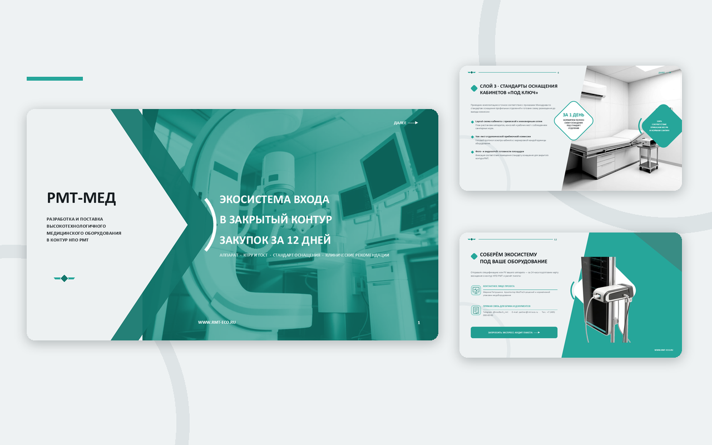](https://mary-rnd.github.io/rmt-eco-presentation/)

---

## Задача, которую решает презентация

Производитель приходит на комиссию с сильным аппаратом — и получает возврат заявки. Причина почти никогда не в самом приборе: код КТРУ не бьётся с комплектацией, в паспорте другая цифра, стандарт оснащения кабинета не подтверждён, клинические рекомендации не приложены. Каждый разрыв — это недели переписки и потерянное окно закупки.

Эта презентация продаёт не «аппарат в коробке», а **экосистему из четырёх синхронизированных слоёв**, которая закрывает все формальные требования комиссии до её начала:

1. **Оборудование и сервис** — РУ, техпаспорт, модульная архитектура, регламент ТО.
2. **КТРУ и ГОСТ** — таблица «код ↔ артикул ↔ страница паспорта», декларации в пакете.
3. **Стандарты оснащения** — layout-схема кабинета и чек-лист приёмочной комиссии.
4. **Клинические рекомендации** — протокол применения, обучение врачей, эксперт на защите.

Главный оффер — **срок входа в контур: 40 дней → 12 дней**.

---

## Кому подойдёт

- производителям и дистрибьюторам медоборудования, которые выходят на закрытые закупки;
- поставщикам, у которых заявки регулярно возвращают по формальным основаниям;
- отделам продаж и тендерным специалистам — как готовый инструмент первого контакта с ЛПУ;
- маркетингу MedTech-компаний — как основа для коммерческого предложения и выступления на комиссии.

---

## Что внутри: 12 слайдов

| № | Слайд | Что продаёт |
|---|---|---|
| 01 | Обложка «Экосистема входа в закрытый контур закупок за 12 дней» | Позиционирование и главный оффер |
| 02 | Почему заявки застревают перед комиссией | Боль закупщика: 40 дней и 6 документов в 3 контурах |
| 03 | Ключевые возможности экосистемы «РМТ-МЕД» | Четыре слоя как единая система |
| 04 | Слой 1 · Оборудование и сервисный контур | РУ, модульность, ЗИП, монтаж, диагностика, обновления |
| 05 | Слой 2 · Сшивка КТРУ, ГОСТ и техзадания | 100 % позиций проходят выверку, 0 возвратов |
| 06 | Слой 3 · Стандарты оснащения кабинетов «под ключ» | Layout-схема, чек-лист, фотоотчёт за 1 день |
| 07 | Слой 4 · Клинические рекомендации и обучение | Протоколы, 2 сессии обучения, эксперт в комиссии |
| 08 | Как проходит комиссия: 40 дней → 12 дней | Таймлайн Д0 / Д3 / Д5 / Д12 и ускорение ×3,3 |
| 09 | Результаты внедрения экосистемного подхода | 3 филиала, 28 позиций КТРУ, 0 отклонений |
| 10 | Риски закупщика и как мы их снимаем | Три риска → три гарантии, зафиксированные в договоре |
| 11 | Как начинаем работу: пилотный запуск в 3 шага | Экспресс-аудит → отделение-пилот → защита на комиссии |
| 12 | Соберём экосистему под ваше оборудование | Контакты и призыв к действию |

### Все слайды

| | |
|---|---|
| 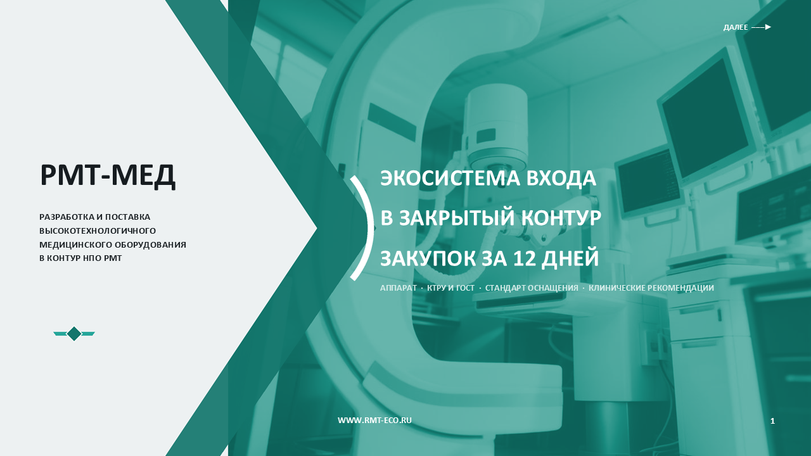 | 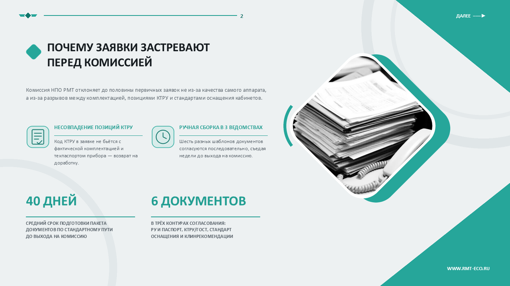 |
| 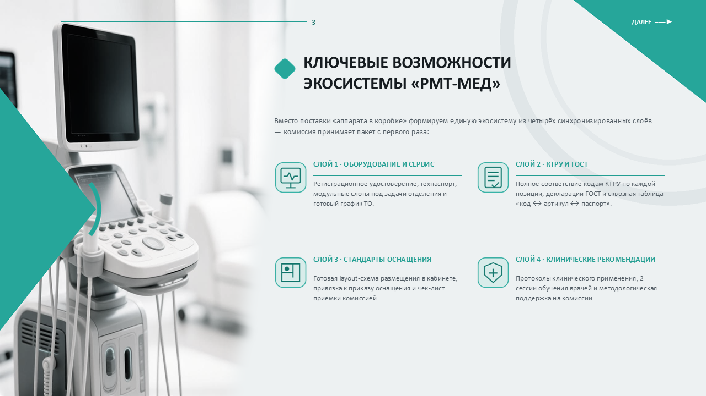 | 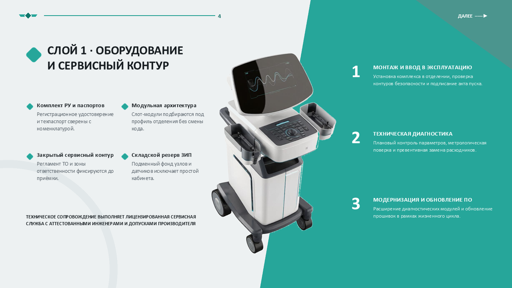 |
| 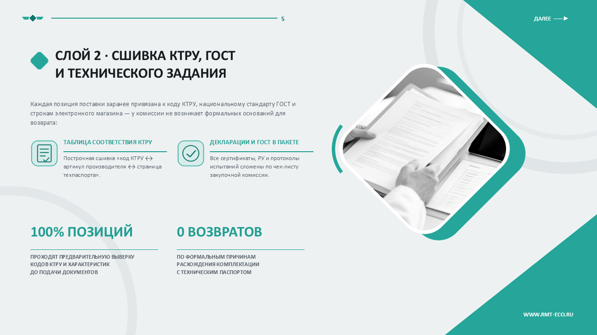 | 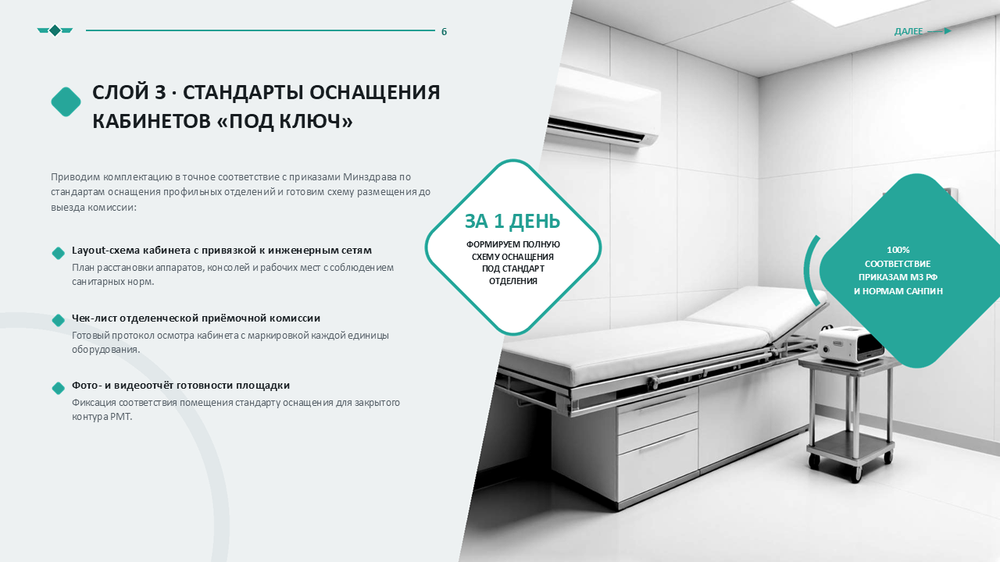 |
| 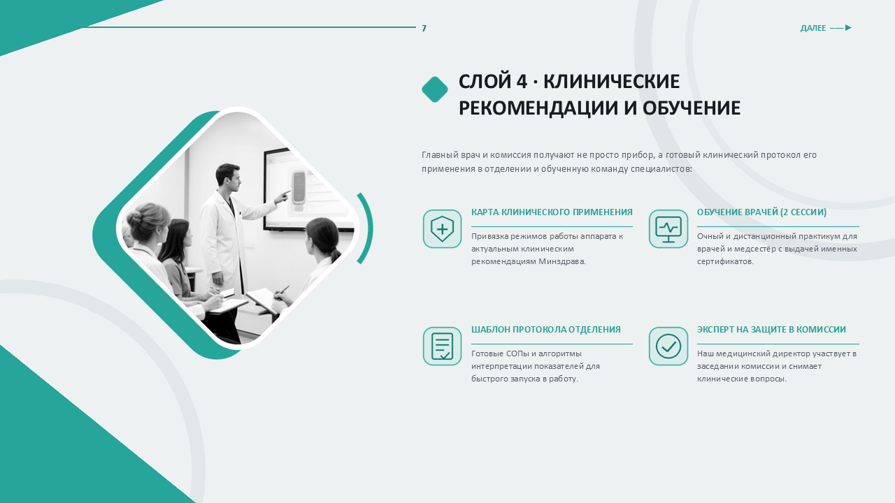 | 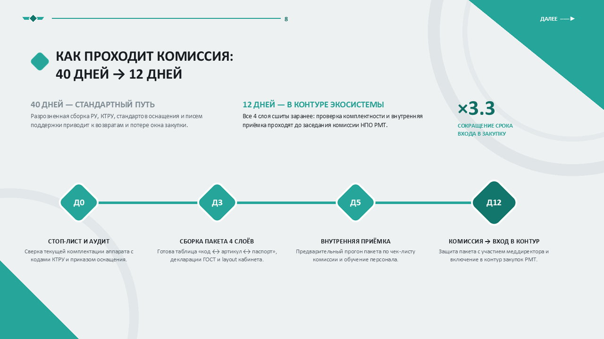 |
| 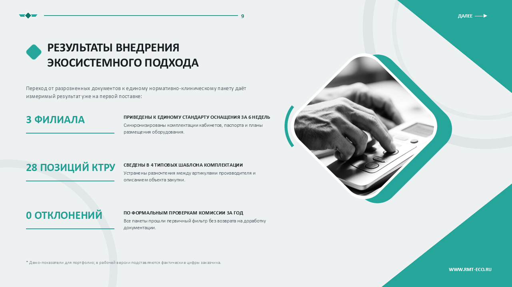 | 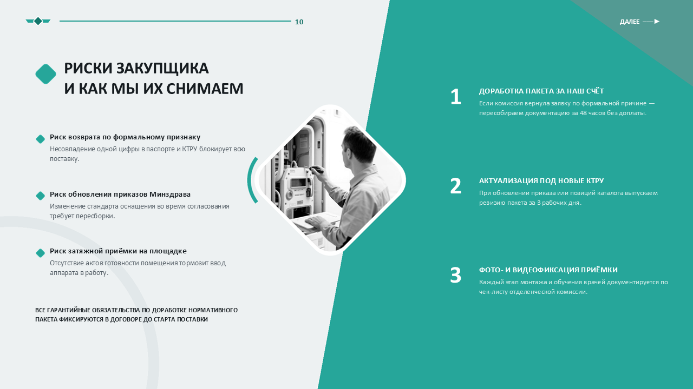 |
| 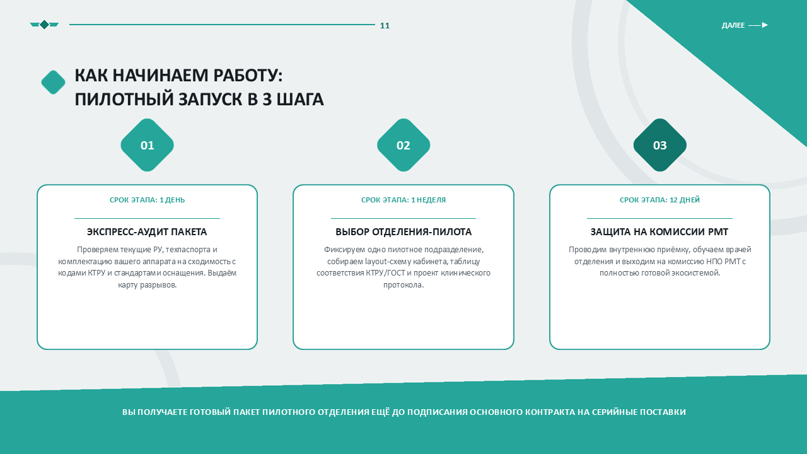 | 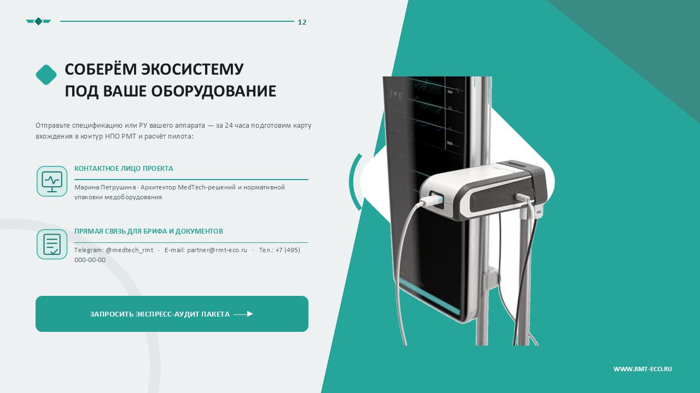 |

---

## Что вы получаете

| Файл | Назначение |
|---|---|
| [`rmt-ecosystem-presentation-v2.pptx`](presentation/rmt-ecosystem-presentation-v2.pptx) | Редактируемая версия: весь текст — отдельными слоями PowerPoint, можно менять под свой бренд |
| [`rmt-ecosystem-presentation-v2.pdf`](presentation/rmt-ecosystem-presentation-v2.pdf) | Готовая версия для отправки клиенту и печати, 16:9 |
| `screenshots/slide-01…12.png` | 12 PNG-рендеров 1280×720 для писем, соцсетей и коммерческих предложений |

Файлы отдаются без водяных знаков и ограничений по использованию внутри вашей компании.

---

## Дизайн

Презентация собрана по строгой дизайн-системе медицинского бренда:

- светло-серый фон `#EEF2F3`, бирюзовая геометрия `#26A69A` и глубокая бирюза `#13766C`;
- чёрно-белые фотографии оборудования — цвет в макете даёт только графика;
- скруглённые ромбы с фотографиями, дужки-скобки, наклонные панели, нумерованные блоки;
- вырезы приборов в натуральном цвете поверх композиции;
- крупные цифры-показатели и линейные иконки — всё читается с проектора и с телефона.

Слайды 3 и 4 намеренно используют разные визуалы: УЗИ-стойка и передвижная диагностическая станция.

---

## Технические детали

| Параметр | Значение |
|---|---|
| Формат | 16:9, 1920 × 1080 |
| Количество слайдов | 12 |
| PPTX | текст редактируется, фоны — растровые композиты, шрифт Calibri |
| PDF | готов к отправке, без правок |
| PNG | 1280 × 720, по одному на слайд |
| Язык | русский |

---

## Цена и как заказать

**4 000 ₽** — готовая презентация со всеми файлами (PPTX + PDF + 12 PNG).

Что входит:

- 12 слайдов в фирменной бирюзовой дизайн-системе;
- редактируемый PPTX и PDF для отправки;
- 12 PNG-рендеров для писем и соцсетей;
- бесплатная замена контактов и логотипа на ваши.

**Адаптация под ваш бренд** (цвета, фотографии вашего оборудования, цифры и кейсы, название компании) — от 2 500 ₽, срок 1–2 дня. Если нужна презентация с нуля под конкретную закупку — обсудим отдельно.

### Как купить

1. Напишите в Telegram [@marypetrova6](https://t.me/marypetrova6) или на [mar.petrushina@yandex.ru](mailto:mar.petrushina@yandex.ru).
2. Укажите название компании и какие контакты поставить на слайд 12.
3. После оплаты получаете ссылку на файлы в течение рабочего дня.

Оплата: перевод на карту или счёт. Для юрлиц — договор и закрывающие документы.

---

## Важно знать

- Цифры на слайде 9 (3 филиала, 28 позиций КТРУ, 0 отклонений) — **демонстрационные**. В рабочей версии подставляются фактические результаты заказчика; на слайде стоит сноска.
- Контакты на слайде 12 — **плейсхолдеры** (Марина Петрушина, `@medtech_rmt`, `partner@rmt-eco.ru`, телефон). Перед использованием заменяются на ваши бесплатно.
- Название «РМТ-МЕД» и оффер — шаблонные: презентация рассчитана на компанию, работающую с контуром НПО РМТ, и адаптируется под ваше позиционирование.
- Изображения оборудования в демо-версии — сгенерированные визуалы, а не фотографии конкретных изделий. При адаптации заменяются на фото вашего парка.

---

## Как это сделано

Макет собран кодом: Python, Pillow и python-pptx. Композитные фоны генерируются попиксельно, текст накладывается отдельными редактируемыми слоями PowerPoint — поэтому презентация не «сплющена» в картинки и правится без дизайнера.

---

## Ссылки

- **Галерея слайдов:** [mary-rnd.github.io/rmt-eco-presentation](https://mary-rnd.github.io/rmt-eco-presentation/)
- **Лендинг MedTech:** [mary-rnd.github.io/medtech-landing](https://mary-rnd.github.io/medtech-landing/)
- **Telegram:** [@marypetrova6](https://t.me/marypetrova6)
- **Почта:** [mar.petrushina@yandex.ru](mailto:mar.petrushina@yandex.ru)

---

© 2026 Марина Петрушина · MedTech. Демо-материалы предоставляются для ознакомления; права на дизайн и тексты принадлежат автору.
